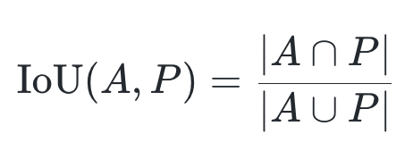

_By Omri Mendels_


## A Tale of Two Numbers

Suppose you're choosing a PII detection model for your organization or platform. You run two candidates (call them Model A and Model B) on the same annotated test set. Model A reports an accuracy (e.g., F2, which penalizes false negatives more than false positives) of 0.91. Model B reports 0.78. You pick Model A.

Then you deploy it, and privacy incidents keep happening.

What went wrong? Possibly nothing with the model itself. The numbers were real; they just weren't measuring what you thought they were measuring.

## PII evaluation is not one question

When evaluating a model for general Named Entity Recognition (NER), the task of locating and classifying named things in text, you're typically asking a single question: how well does this model detect entity type X? PII detection is different because it serves several distinct purposes, each of which requires a different answer:

- **Did the model identify all the private data?** This is the redaction question. You care about false negatives above everything else: a missed name is a privacy leak regardless of what the model called it. In Machine Learning terms, this is a binary classification problem.
- **Did the model correctly identify what kind of PII this is?** This is the auditing question. When gathering statistics on what PII exists in a corpus, you need to know whether a detected entity is a name, a location, or a government ID. In ML terms, this is a multi-class classification problem.
- **How specifically does the model classify PII types?** This is the synthetic substitution question. Replacing a person's initials with a fake full name produces unusable synthetic data. If you want to replace only the year in a date of birth but the model detects a generic `DATE_TIME`, you lose the ability to make that substitution precisely. In other words, this is a hierarchical classification problem.

These three objectives map directly to three levels of evaluation granularity:

| Objective | Evaluation level | Question |
| --- | --- | --- |
| Redact everything | **Binary** | Did the model flag this span as PII? |
| Audit / statistics | **PII Category** | Did the model identify the right _category_? (PERSON, LOCATION, GOVERNMENT_ID, ...) |
| Replace with synthetic | **Detailed Entity** | Did the model identify the right _specific type_? (PERSON or _{first name, last name, initials}_) |

A single aggregate F2 score conflates all three. A model can have excellent binary recall (finds almost all PII) while being mediocre at category-level classification, which is fine for a redaction use case but unacceptable for auditing or synthesis. Reporting only one number forces you to pick which objective you're optimizing for implicitly, and makes it impossible to compare models across objectives.

This is the first structural challenge in PII evaluation: what are you actually measuring?

Three further problems compound to make the answer harder than it looks:

- **Models don't share a label vocabulary.** Two models detecting the same "thing" will call it different names, and naive string comparison treats them as detecting different things.
- **Token-level scoring has structural biases.** While being the simplest approach for evaluation, in token-level scoring, the format of a PII value can weight some misses more heavily than others, independent of whether the model actually detected the entity.
- **Evaluation datasets are rarely representative.** Real PII datasets are almost never available due to privacy constraints, so practitioners fall back on open-source benchmarks (which models are often trained on) or LLM-generated synthetic data (which is unnaturally clean), both of which make models look better than they perform in production.

This post walks through each problem in detail, using concrete examples, and describes the evaluation framework in [presidio-research](https://github.com/microsoft/presidio-research) that addresses them.

## The Label Vocabulary Problem

### Why labels don't line up

Every model and every dataset brings its own entity taxonomy. Your annotated dataset might label personal names as `PERSON`. One model calls it `PER`. Another uses BIO tags: `B-PERSON`, `I-PERSON`. A third, trained on clinical data, emits `PATIENT_NAME`. A compliance-focused model outputs `FULL_NAME` and `FIRST_NAME` as separate types. A regulation-specific model appends country codes: `GERMANY_PASSPORT_NUMBER`, `US_DRIVER_LICENSE`, `AU_MEDICARE`.

If you compare these labels directly, every correct detection looks like a mismatch. A model that perfectly redacts every name in your corpus scores zero recall, because its label is `PER` and your dataset says `PERSON`.

The standard workaround is a hand-crafted alias file: a flat dictionary mapping each model's labels to your dataset's labels. This works at small scale. It breaks down as soon as you add a second or third model, because every new model means manually auditing dozens of new label names and adding them to the dictionary. The dictionary becomes a maintenance liability, its mappings are invisible to anyone reviewing evaluation results, and there's no guarantee different practitioners map the same label the same way.

### The canonical entity hierarchy

A better approach is a shared, model-agnostic vocabulary that both models and datasets map to, rather than mapping to each other. This is what the `CanonicalMapper` in presidio-research implements.

The canonical vocabulary is organized as a three-level hierarchy:

```text
Root
├── PERSON          → NAME, USERNAME, ALIAS
├── CONTACT         → EMAIL_ADDRESS, PHONE_NUMBER, FAX, SOCIAL_HANDLE
├── LOCATION        → STREET_ADDRESS, CITY, COUNTRY, POSTAL_CODE, GEO_COORDINATES
├── ORGANIZATION    → COMPANY, EDUCATIONAL_INSTITUTION, GOVERNMENT_AGENCY
├── GOVERNMENT_ID   → SSN, PASSPORT, DRIVER_LICENSE, TAX_ID, NATIONAL_ID
├── FINANCIAL_PII   → CREDIT_CARD, IBAN, BANK_ACCOUNT, CRYPTO_WALLET
├── PHI             → PATIENT_ID, MRN, HEALTH_INSURANCE, DIAGNOSIS, MEDICATION
├── DATE_TIME       → DATE, TIME, DURATION
└── ...             (DEMOGRAPHIC, EMPLOYMENT, DEVICE_IDENTIFIER, BIOMETRIC, ...)
```

Every label (from any model, from any dataset) gets resolved to a canonical entity through five tiers applied in order:

1. Exact match in the alias map (`EMAIL` → `EMAIL_ADDRESS`, `PER` → `NAME`)
2. BIO tag stripping (`B-PERSON`, `I-PERSON` → `NAME`)
3. Country prefix (`GERMANY_PASSPORT_NUMBER` → `PASSPORT`, `US_DRIVER_LICENSE` → `DRIVER_LICENSE`)
4. Country prefix fallback (`IN_PAN` → strips `IN`, resolves `PAN` → `TAX_ID`)
5. Fuzzy string match at ≥ 0.80 similarity for near-misses like `CREDITCARD` → `FINANCIAL`

If none of these tiers resolve the label, it's flagged as `UNRESOLVED`, a hard error that blocks evaluation until the user manually maps it. This is intentional: silent mismatches are worse than loud failures.

### The three-level evaluation surface

The hierarchy serves a second purpose: it defines three natural levels at which to measure performance.

- **Binary:** did the model detect any PII at all?
- **Category:** did the model detect the right category of PII? (PERSON vs. LOCATION vs. GOVERNMENT_ID)
- **Detailed:** did the model detect the right specific entity type? (NAME vs. PASSPORT vs. EMAIL_ADDRESS)

The evaluation depth is inferred automatically from your dataset. If your annotations use fine-grained labels like `EMAIL_ADDRESS` and `SSN`, the mapper computes a canonical surface at depth 3 (detailed). If your annotations use coarse labels like `PERSON` and `LOCATION`, it computes depth 2 (category). The canonical surface reflects what your data can actually distinguish, with no manual tuning required, and two different users comparing the same model against their respective datasets get consistent, meaningful scores at the right granularity.

A single evaluation run produces all three levels simultaneously:

- **Binary:** Did the model catch the PII and nothing else?
- **Category:** Did it know what kind of PII?
- **Detailed:** Is the entity type specific enough?

A model can have high binary recall (finds most PII) but low detailed recall (mislabels types frequently). These tell you different things about deployment risk.

### When mapping requires human judgment

Canonical mapping resolves most label mismatches automatically, but some cases are genuinely ambiguous and require a decision. Two examples:

A model that outputs `NRP` (nationality/religion/political affiliation) might map to `DEMOGRAPHIC`, while the dataset annotated the same tokens as `LOCATION`. Both are defensible; the mapper flags the conflict and asks you to pick one. Silently choosing either would distort the evaluation in ways that are hard to trace.

A subtler problem runs in the opposite direction: a model may correctly detect entity types that your dataset simply never annotated. Every such prediction looks like a false positive, silently deflating precision, even though the model is doing exactly what it was designed to do. If your test set has no `ORGANIZATION` annotations but the model flags company names throughout, those detections count against it. The mapper surfaces this so you can decide whether to add the missing annotations, suppress that entity type from evaluation, or explicitly acknowledge it as out of scope.

## The Boundary Problem

### What token-level evaluation actually measures

Token-level evaluation is the default in NER benchmarks: split text into tokens, assign each a label, compare predicted label vs. gold label token by token, aggregate into precision/recall/F2. Simple, transparent, and widely implemented.

The problem isn't boundary sensitivity per se; it's that token-level scoring has two structural biases that quietly distort comparisons.

**Multi-token entities are penalized proportionally more than single-token ones.**

Consider the same phone number in two formats:

| Text | Gold | Prediction | Token errors |
| --- | --- | --- | --- |
| `5551215553` | `[PHONE]` | `[O]` | 1 FN |
| `555-121-5553` | `[PHONE, PHONE, PHONE, PHONE, PHONE]` | `[O, O, O, O, O]` | 5 FN |

Both represent identical PII, and the model missed both entirely. But the hyphenated version contributes five times as many false negatives to the confusion matrix. The formatting of the value, something the model has no control over and the annotator may not have standardized, determines how heavily a miss is counted.

**Skip words inside entity spans generate phantom errors.**

Many multi-token entities contain function words that some taggers annotate as non-entities. "University of Washington" is a canonical example: the gold annotation might be `[ORG, O, ORG]` if the annotator tagged `"of"` as non-PII, while the model correctly outputs `[ORG, ORG, ORG]` treating it as a single organization span. Token-level evaluation sees one false positive (the model's `"of"` prediction) even though the model got the entity right.

The reverse happens too: a model trained to emit clean spans will output `[ORG, O, ORG]`, fragmenting "University of Washington" into two separate organization predictions. Token-level evaluation sees two true positives but the redaction pipeline produces two separate redacted spans with a gap, which may or may not be the intended behavior, depending on whether `"of"` carries identifying information in context.

These aren't edge cases. They occur wherever PII entities contain prepositions, articles, or punctuation that sits ambiguously between "part of the entity" and "surrounding text": "Bank of America", "Dr. Jane Doe", "42 Main St, Apt. 3B".

### IoU-based span evaluation

Presidio Evaluator's `SpanEvaluator` operates at the entity level rather than the token level. It treats each entity as a single span with character boundaries, and uses Intersection over Union (IoU) to determine whether a predicted span and an annotated span match:



_Intersection Over Union. A - Annotation, P - Prediction_

A match is declared when IoU ≥ θ (default θ = 0.75), configurable per use case. This resolves both structural problems above:

- **Multi-token penalty is gone.** Whether the entity is one token or ten, it counts as one annotated span and one predicted span. Missing `555-121-5553` contributes exactly one FN, same as missing `5551215553`.
- **Skip word artifacts are eliminated explicitly.** The `SpanEvaluator` accepts a configurable `skip_words` list. Words on this list (prepositions, articles, punctuation marks) are ignored when merging adjacent same-type tokens into a single span before IoU is computed. "University of Washington" with `of` as a skip word collapses into one span regardless of how the model or annotator tagged `"of"` individually.

The IoU threshold also provides proportional credit for near-misses. A model that detects only "John" from "John Michael Smith" scores an IoU of 0.33, below the default threshold, counted as a miss. A model that detects "Dr. John Smith" when the annotation is "John Smith" scores an IoU of ~0.67, a near-miss rather than a clean hit.

The evaluator also handles the common case where a model emits multiple overlapping predictions for the same annotated span. If a model predicts `[ORG, O, ORG]` for "University of Washington", the two `ORG` spans are combined before IoU is computed against the gold annotation. Multiple predictions of the same type over the same region count as one prediction, not two TPs, which would overcount correct detections.

Both mechanisms, label mapping and span merging, are often needed together. Consider a clinical record:

```text
Input:      Patient name: Kenobi, Obi-Wan
Model:      Patient name: [LAST_NAME], [FIRST_NAME]
Dataset:    Patient name: [PERSON]
```

Label mapping resolves `LAST_NAME` and `FIRST_NAME` to the same canonical entity as `PERSON`. The model now has two predicted spans where the dataset has one. The comma between them is ignored, so the evaluator merges the two predictions into a single span before computing IoU. The merged span aligns with the annotated `[PERSON]` span, and the model receives full credit, which is the correct outcome, since it identified both components of the name precisely.

## The Dataset Problem

The dataset problem has three layers that compound each other.

### Real PII data is effectively unreachable

The most accurate evaluation data would be real documents containing real PII, annotated by domain experts. While this data exists inside healthcare systems, financial institutions, HR platforms, and the customer service queues of large organizations, it is almost never accessible for evaluation purposes.

Even teams building de-identification tools within those organizations frequently can't use production data for benchmarking. Legal constraints, privacy regulations, and data governance policies mean that the data most relevant to the problem is the data you're least able to touch. The result is that virtually all published PII evaluation is done on proxy datasets that differ from the deployment context in ways that matter.

### Open-source datasets are often in the training set

The obvious fallback is open-source annotated corpora. The problem is that the most widely used ones have already been incorporated into the training pipelines of the models you're trying to evaluate.

The most widely used corpora span real annotated data - CoNLL 2003 (Reuters newswire) and i2b2 (clinical notes) - as well as explicitly synthetic datasets like `ai4privacy/pii-masking-300k` on Hugging Face and the training data for Nvidia's Nemotron models. In each case, these datasets have been incorporated into popular fine-tuning pipelines, meaning models evaluated on samples from those distributions have effectively seen the test data.

Evaluations of these models using the training datasets reflect memorization of a distribution as much as genuine detection capability. When you deploy such a model on customer service chat logs or multilingual intake forms, it encounters text that looks nothing like the training data, and performance drops sharply.

### LLM-generated datasets are unnaturally clean

Generating fresh evaluation data with GPT-5 or Claude avoids the contamination problem. But it introduces a different one: LLM-generated text is too clean.

Real PII-bearing text is noisy in ways that matter for detection:

- **Casing errors:** "john doe" and "JOHN DOE" are common in real transcripts; LLMs default to standard casing.
- **Typos and OCR artifacts:** "Jahn Smth", "johnn@examp1e.com". LLMs rarely produce these.
- **Speech-to-text artifacts:** "my name is john smith my phone number is five five five", with no punctuation, numbers spelled out, entity boundaries unclear.
- **Multi-turn fragmentation:** PII is often spread across multiple turns in a conversation, with no single span containing the full value. A credit card number dictated digit-by-digit while an operator reads it back looks nothing like a contiguous 16-digit string:

```text
Operator: What's your credit card number?
Customer: 1664
Operator: Yes
Customer: 5122
Operator: Aha
Customer: 3371
…
```

The practical consequence is that models evaluated on LLM-generated data appear to perform well because the test text matches the clean, well-formed input those models were trained on. The cleanliness gap only becomes visible after deployment.

None of this means synthetic data is useless. It's valuable for controlled experiments and for covering rare entity types. The mistake is treating it as a proxy for real-world performance without accounting for what it doesn't capture.

### What good evaluation data looks like

Good PII evaluation data has a short checklist:

- **Held-out from training.** Models being evaluated should have no access, direct or indirect, to the test data.
- **Realistic noise distribution.** Typos, casing inconsistencies, punctuation variation, and speech artifacts should appear at rates consistent with the deployment domain.
- **Representative PII coverage.** The entity types in the test set should match the types the model will encounter in production, not just the types that are easy to annotate.
- **Clear annotation guidelines.** Annotators should agree on boundary rules, especially for titles, nested entities, and implied PII.
- **Multi-domain coverage.** A single-domain test set (news, clinical, social media) will not generalize.

The presidio-research data generator produces synthetic datasets from templates, allowing controlled noise injection: typos, casing shifts, date format variation. Combining templates generated by LLMs and manually created ones can bring more realistic results. Moreover, using tools like Faker and real PII dictionaries often creates better distributions than asking the LLM to come up with a value. It's a partial solution to the cleanliness problem, not a complete one.

## Putting It Together

The three problems described above (label mismatch, token-level scoring bias, and dataset contamination) are independent but compound. A clean evaluation pipeline needs to address all three, in sequence:


The pipeline makes the comparison claim explicit: two models evaluated through this pipeline on the same dataset are measuring the same thing, using the same canonical vocabulary, the same boundary tolerance, and the same hierarchical decomposition of performance.

In practice, this means:

- Model A calls names `PER`, Model B calls them `FULL_NAME`, your dataset says `PERSON`. All three resolve to `NAME` in the canonical hierarchy. The comparison is fair.
- A phone number written as `555-121-5553` and one written as `5551215553` both contribute one annotated span to the denominator, regardless of how many tokens the tokenizer produces.
- At the end, you get three F2 numbers per model: binary (found any PII?), category (right category?), detailed (right type?). These tell a richer story than a single aggregate score.

The motivating scenario from the introduction (Model A reporting 0.91 and Model B 0.78 on the same dataset) often inverts when you run through this pipeline. Model A may have been benefiting from label leakage (its label vocabulary matched the dataset's exactly, while Model B's didn't), or from token-level scoring that rewarded its tokenizer's coincidental alignment with the test corpus, or both. Canonical mapping and span evaluation remove both of those advantages and leave the comparison grounded in what actually matters:

Does the model find PII, with the right type, within a reasonable boundary tolerance? That's the question the evaluation pipeline is designed to answer honestly.

---

The evaluation framework described here is part of [microsoft/presidio-research](https://github.com/microsoft/presidio-research).

This work was done jointly with the amazing Presidio team: Sharon Hart, Coby Peled, Nava Vaisman Levy, Noa Gruber Uziely, Ron Shakutai, and many other contributors.

_This post was originally published [on Medium](https://omri-mendels.medium.com/evaluating-pii-detection-models-fa0c745d7a4c)._
